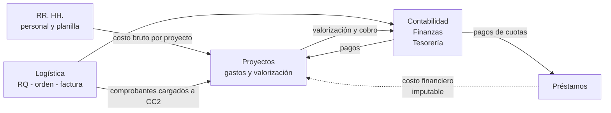

# 00. Resumen ejecutivo de la Parte 1: análisis de datos del cuadro de mando

**Alcance:** análisis de los archivos de `c_mando/data/` (Proyectos, Préstamos, Logística, RR. HH.) siguiendo las instrucciones de [../../README.md](../../README.md). Esta es la **primera etapa**; no incluye desarrollo de la aplicación.

**Regla de confidencialidad:** según `GUIA_TRABAJO.md`, los documentos no contienen nombres de personas, DNI, cuentas ni importes por persona. Las cifras son agregadas y de los archivos de ejemplo.

## 1. Índice de documentos

| Documento                                                | Contenido                                                                                   |
| -------------------------------------------------------- | ------------------------------------------------------------------------------------------- |
| [01_proyectos.md](01_proyectos.md)                       | Libro modelo `Collana 09-11.xlsx` y plantilla de planilla de RR. HH. por proyecto           |
| [02_prestamos.md](02_prestamos.md)                       | Archivo de cronograma de préstamos (arquitectura, fórmulas, defectos)                       |
| [03_logistica.md](03_logistica.md)                       | Cinco exportaciones: requerimientos, órdenes y facturas, Contabilidad, Finanzas y Tesorería |
| [04_rrhh.md](04_rrhh.md)                                 | Maestro de personal, marcaciones, planilla, formatos AFP y SCTR, planilla por proyecto      |
| [05_arbol_y_modelo_datos.md](05_arbol_y_modelo_datos.md) | Árbol del cuadro de mando, dimensiones, hechos y relaciones                                 |
| [06_propuesta_kpi.md](06_propuesta_kpi.md)               | Propuesta de indicadores por área, con fórmula, fuente y prioridad                          |
| [07_archivos_limpios.md](07_archivos_limpios.md)         | Archivos de entrega propuestos por oficina                                                  |
| [08_preguntas_clave.md](08_preguntas_clave.md)           | Preguntas que debe responder cada responsable de área                                       |

Cada informe 01 a 04 se puede leer de forma independiente: describe qué es el archivo, su estructura, su lógica y fórmulas, sus relaciones y sus defectos.

## 2. Qué hay en los datos (una línea por área)

| Área          | Archivos                                                                                        | Calidad                                                         | Lectura general                                                                                     |
| ------------- | ----------------------------------------------------------------------------------------------- | --------------------------------------------------------------- | --------------------------------------------------------------------------------------------------- |
| **Proyectos** | Un libro por proyecto (modelo: Collana), con presupuesto, valorizaciones, gastos y valor ganado | Media. Lógica útil pero con alcances mezclados y datos manuales | Es la base natural del módulo de rentabilidad por proyecto                                          |
| **Préstamos** | Un libro con 30 hojas de deuda y un motor de cuotas                                             | Media. Bien pensado, con errores y supuestos ocultos            | Muestra una deuda de S/ 14.2 M (S/ 9.3 M por pagar), concentrada en pocos acreedores y en diciembre |
| **Logística** | Cinco exportaciones de sistema                                                                  | Alta en estructura, media en consistencia                       | Cadena completa RQ → orden → factura → pago ya trazable; falta unificar llaves y catálogos          |
| **RR. HH.**   | Maestro, reloj, planilla y formatos                                                             | Datos de ejemplo; estructura clara                              | Suficiente para diseñar; faltan datos reales para medir                                             |

## 3. Lo más importante que se descubrió

1. **Los datos ya contienen la cadena de compras completa**, desde el requerimiento hasta el pago. Hay llaves que cruzan perfectamente (orden → RQ, comprobante → orden, Contabilidad → orden).
2. **Los puntos de unión entre áreas no existen o están vacíos.** El gasto del proyecto no trae el número de orden (columna `RQ` vacía en las 386 filas); la planilla por proyecto usa el proyecto como texto libre; el costo financiero no está asignado a proyectos. Sin estos vínculos, el cuadro de mando sería cuatro tableros separados.
3. **Falta un catálogo único de proyecto / centro de costo.** Hay al menos tres nombres para el mismo proyecto (Logística, Contabilidad y el libro del proyecto). La propuesta es adoptar el código CC2 de Contabilidad.
4. **El valor ganado del libro de Collana no es comparable.** El mismo proyecto da CPI 1.19 o 2.08 según el alcance del costo real; hay IGV en el presupuesto y no en el gasto. Hay que definir el alcance antes de publicar indicadores.
5. **El archivo de préstamos asume que lo vencido está pagado.** No hay registro real de pagos; una hoja de resumen oculta tiene errores. La deuda por pagar es de S/ 9.3 M y el mes de diciembre concentra más de la mitad.
6. **Hay deuda comercial vencida.** De 200 comprobantes por pagar, 144 ya vencieron (≈ S/ 2.3 M); 85 % de los RQ es de emergencia o regularización.
7. **Contabilidad, Finanzas y Tesorería son la misma tabla en tres etapas.** Se pueden unificar sin perder información, y eliminan columnas repetidas (el monto de la orden se repite en cada comprobante).
8. **Datos sensibles en todas las áreas:** cuentas, CCI, nombres, DNI, edades, familia. Solo agregados deben llegar al cuadro de mando.
9. **Parámetros legales y de negocio dentro de fórmulas:** tipo de cambio (3.5 y 3.45), 70 % de meta, 13 % y 10 % de gastos generales y utilidad, AFP, EsSalud. Deben ser tablas con vigencia.
10. **Los datos de RR. HH. son de ejemplo.** Sin la base completa no se puede estimar la dotación real, el costo de personal por proyecto ni las tardanzas.

## 4. Cómo se relacionan las áreas

Las líneas continuas son relaciones que ya existen en los datos (con calidad variable); la discontinua es una relación que hay que crear.

## 5. Estructura propuesta del cuadro de mando

Resumen gerencial + cinco pestañas: **Proyectos**, **Logística y pagos**, **Préstamos y deuda**, **Recursos humanos** y **Calidad de datos**. Detalle en [05_arbol_y_modelo_datos.md](05_arbol_y_modelo_datos.md). Indicadores: más de 50 propuestos, con una primera versión (prioridad A) de unos 38 que se pueden calcular **con los datos que ya existen** ([06_propuesta_kpi.md](06_propuesta_kpi.md)).

## 6. Archivos limpios propuestos

Cinco grupos de entrega más seis catálogos ([07_archivos_limpios.md](07_archivos_limpios.md)):

- **Proyectos:** gastos, valorización, presupuesto y ficha. Se obtienen del libro actual añadiendo cuatro columnas.
- **Logística:** las tres exportaciones actuales, con ajustes en origen.
- **Contabilidad / Finanzas / Tesorería:** una sola tabla de comprobantes, que cada oficina completa en sus campos.
- **Préstamos:** catálogo, cuotas y pagos (nueva tabla).
- **RR. HH.:** personal, costo por proyecto, planilla, marcaciones y obligaciones.

## 7. Decisiones que se necesitan antes de la Parte 2

Las preguntas completas están en [08_preguntas_clave.md](08_preguntas_clave.md). Las **bloqueantes** son:

1. **Alcance del valor ganado** y tratamiento del IGV, de la precontractual y de los préstamos en el costo del proyecto (P-01, P-02, P-04, P-10).
2. **Lista oficial de proyectos y centros de costo** con código único (P-16).
3. **Origen y frecuencia de las exportaciones** de Logística y de Contabilidad / Finanzas / Tesorería (L-01, C-01).
4. **Cómo registrar el pago real** de cuotas de préstamos (F-04).
5. **Fuente completa del personal**, categorías y código del reloj (H-01, H-03, H-05).
6. **Tratamiento de la deuda personal del gerente** (G-03).
7. **Flujo de caja:** si se incluyen ingresos, de dónde salen (C-09).

## 8. Siguiente paso

Con las respuestas de la sección 7 se cierra el diseño de datos y de indicadores, y se pasa a la **Parte 2** (desarrollo de la aplicación). No se inició ningún desarrollo; la Parte 2 depende de las decisiones anteriores.
