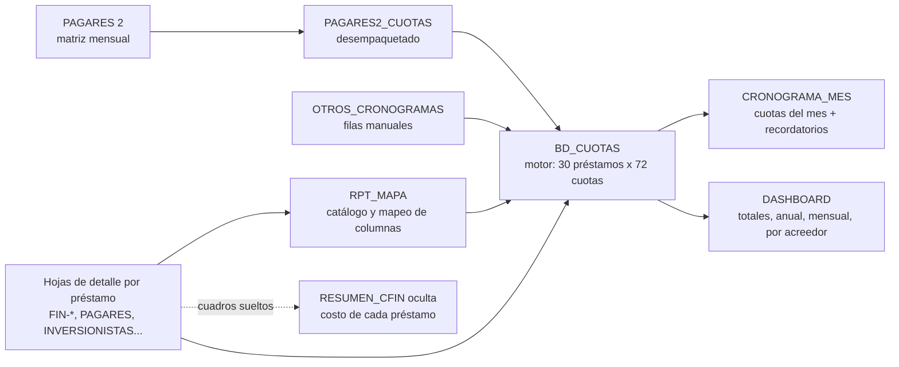

# 02. Préstamos: informe del archivo `Cronograma-Prestamos-Detalle-2026_REPORTE_actualizado.xlsx`

**Alcance:** único archivo de `data/prestamos/`. Fue elaborado con apoyo de IA, por lo que tiene arquitectura de "motor + reportes" bastante más sofisticada que el resto de los archivos de la empresa. Cifras con fecha de corte 10/11/2026 y tipo de cambio 3.45 S/ por US$.

## 1. Qué es y para qué sirve

Consolida **todas las deudas financieras del grupo**: préstamos bancarios, financiamiento de inversionistas y fondos (modalidad *bullet*), pagarés con personas y empresas, y obligaciones personales del gerente (tratadas como deuda "de la empresa" porque sus cuotas se pagan desde Tesorería). Su objetivo es responder cuatro preguntas:

1. ¿Cuánto debemos en total y a quién?
2. ¿Qué cuotas vencen este mes y cuándo hay que programar el pago?
3. ¿Cuánto nos cuesta el dinero (intereses, comisiones, seguros)?
4. ¿Cómo se distribuyen los vencimientos en el tiempo?

## 2. Resultados principales (S/ equivalentes)

| Indicador                                                      | Valor                                                     |
| -------------------------------------------------------------- | --------------------------------------------------------- |
| Total de la deuda (capital + interés + otros)                  | 14,163,108                                                |
| Ya realizado (pagado)                                          | 4,822,197                                                 |
| Por pagar                                                      | 9,340,911                                                 |
| Capital por pagar                                              | 7,667,985                                                 |
| Costo financiero total (interés + otros costos + sin desglose) | 3,722,267                                                 |
| % del costo financiero ya realizado                            | 55 %                                                      |
| Cuotas con vencimiento en nov-26                               | 28 (S/ 1,347,916 + US$ 194,387, equivalente S/ 2,018,550) |

Por año (total de cuotas): 2025 S/ 0.21 M · 2026 S/ 10.37 M (de los cuales 4.61 M realizados) · 2027 S/ 2.33 M · 2028 S/ 0.85 M · 2029-2031 residual.

Meses de mayor presión: **dic-26 S/ 4.87 M** (por un capital *bullet* grande), nov-26 S/ 2.02 M, oct-26 S/ 1.23 M. La deuda por pagar está **muy concentrada**: tres acreedores (un pagaré de una persona natural, Insales Capital y BBVA) superan S/ 1 M cada uno.

Por deudor: DPH, DPHC, DPH Carga y Transporte, Cosudeco, Perú Seguros 365 y el gerente a título personal. Por acreedor: BBVA, Caja Arequipa, Caja Piura, Mi Banco, Insales Capital, Inversiones IO, un grupo de inversionistas y pagarés con personas y empresas.

## 3. Arquitectura del libro

| Hoja                    | Rol                                                                                                                                                                                                                                                                                                                            | Observaciones                                                                                     |
| ----------------------- | ------------------------------------------------------------------------------------------------------------------------------------------------------------------------------------------------------------------------------------------------------------------------------------------------------------------------------ | ------------------------------------------------------------------------------------------------- |
| `DASHBOARD`             | Tablero: filtros empresa y acreedor, KPIs, resumen anual, evolución de 24 meses, ranking de acreedores y top 10 por costo financiero                                                                                                                                                                                           | Todo con `SUMIFS` sobre `BD_CUOTAS!$6:$2443`. Fecha de corte `=TODAY()`. TC = `CRONOGRAMA_MES!G5` |
| `CRONOGRAMA_MES`        | Se elige el mes (D5), la empresa y la moneda. Lista las cuotas del mes, con **fecha límite de pago = vencimiento − 4 días** y un recordatorio (⚠ si ya pasó la fecha límite, "Vence HOY")                                                                                                                                      | Capacidad máxima de 100 cuotas por mes (hay un aviso). Lista construida con `SMALL` + `INDEX`     |
| `RPT_MAPA`              | **Catálogo de préstamos**: hoja de detalle, incluir SI/NO, empresa, acreedor, nombre, moneda, fila de la primera cuota y **letra de cada columna** (N.º cuota, fecha, interés, capital, total). Además las listas de filtros                                                                                                   | Es la pieza que permite que 20+ hojas con formatos distintos entren a un solo motor               |
| `BD_CUOTAS`             | **Motor**: 30 "slots" de préstamo × hasta 72 cuotas = 2,160 filas útiles (rango 6-2443). Usa `INDEX` sobre cada hoja según el mapeo. Calcula estado, mes, interés, capital, otros, costo financiero y "realizado vs por pagar"                                                                                                 | ~33,900 fórmulas. Si hay más de 30 préstamos o más de 72 cuotas, no entran                        |
| `OTROS_CRONOGRAMAS`     | Cuotas sin hoja propia, anotadas a mano desde Tesorería de oct-26 (Caja Arequipa, Mi Banco, tarjetas de negocios)                                                                                                                                                                                                              | Datos sueltos, sin proyección futura                                                              |
| `PAGARES` y `PAGARES 2` | Registro de pagarés (capital, tasa, fechas) y **matriz mensual** pagaré × mes                                                                                                                                                                                                                                                  | `PAGARES 2` tiene formato de matriz y no de lista                                                 |
| `PAGARES2_CUOTAS`       | Convierte la matriz en cuotas (día de pago, último mes con interés, capital S/ y US$, acreedor que agrupa pagarés)                                                                                                                                                                                                             | Supuestos escritos en fórmulas (ver hallazgos)                                                    |
| `RESUMEN_CFIN` (oculta) | Por préstamo: capital, cuotas, costo total, % de costo, TCEA, deuda total, pagado, pendiente                                                                                                                                                                                                                                   | **Contiene errores** (ver sección 6)                                                              |
| Hojas de detalle        | Una por préstamo o por grupo (FIN-IO-001/002/003, INVERSIONISTAS, FIN-BBVA-001/002/003, BBVA personal, MI BANCO, FIN-ARE-001/002/003, FIN-INSALES-001/002, FIN-PIURA, FIN-PIURA II/III, DPH C&T-PIURA, Cosudeco-Piura, Perú Seg 365-Piura, DPHC-Piura, pagarés individuales y tres hojas ocultas cuyo origen debe confirmarse) | Formatos **heterogéneos** entre sí                                                                |

## 4. Lógica de cálculo (resumen)

- **Estado de cuota.** `PAGADO` si hay "Pago real" o, en algunas hojas, **si la fecha de vencimiento ya pasó respecto a `TODAY()`**. Es decir, el archivo asume que una cuota vencida está pagada. Esto no es un registro de pagos reales.
- **Realizado / por pagar.** Indicador 1/0 por cuota según estado; el dashboard suma separando por moneda y convierte con un único TC.
- **Costo financiero** = interés + otros costos (seguros, ITF, IGV, comisiones) + "sin desglose" (cuotas donde no se separó interés de capital).
- **Préstamos *bullet* (Inversiones IO, inversionistas):** interés mensual = capital × TNA / 12 (TNA 20 % en el ejemplo); capital al final. Cabecera con capital, monto desembolsado, comisión (9 %) + IGV, desembolso neto, validación y tabla de cuotas con columnas `Saldo inicial, Interés, Capital, Total cuota, Fecha pago, Pago real, Días mora, Mora, Estado`.
- **Préstamos bancarios (sistema francés, cuota fija):** cabecera con número de préstamo, cuenta de cargo, monto desembolsado, capital pendiente, TEA, fechas; tabla de cuotas con interés, amortización, seguros, ITF.
- **Pagarés:** matriz de montos por mes; el desempaquetado asume día de pago fijo y último mes con interés.
- **Filtros del dashboard** por empresa y acreedor: la cadena de criterio es `*` cuando se selecciona "TODAS".
- **Ranking de acreedores:** `LARGE` sobre un valor auxiliar con desempate por posición (suma de un número pequeño según la fila).

## 5. Relación con otros archivos

- **Proyectos:** cuotas de préstamos aparecen como gastos de proyecto (`Gastos`, ejemplo: "pago de préstamo" de Inversiones IO). Si el préstamo financió la obra, el costo financiero debería imputarse al proyecto; hoy no hay regla.
- **Logística / Tesorería:** las cuotas de préstamo salen de Tesorería; `OTROS_CRONOGRAMAS` ya se alimenta de la hoja de Tesorería de octubre. Una **cuota de préstamo es una obligación de pago** igual que una factura: la programación de pagos debería ser común.
- **RR. HH.:** no hay relación, salvo préstamos y adelantos a trabajadores (en `HONORARIOS` y planilla).

## 6. Hallazgos de calidad

1. **Fórmulas `_xludf.MINIFS` / `_xludf.MAXIFS` en `RPT_MAPA!P:Q`** devuelven `#NAME?` (la función no se reconoció al guardar). Afecta a "Primera cuota" y "Última cuota", que son informativas.
2. **`RESUMEN_CFIN` inconsistente:** TCEA de −97 % en una fila, total de deuda negativo en `H14` (−6.8 M), referencias cruzadas equivocadas (la fila `F20` apunta a `FIN-IO-001` y la fila `FIN-CRE-001` muestra un total de 7.45 M por una suma de rango mal definido). No se debe usar como fuente.
3. **Encabezados que no coinciden con el contenido.** Por ejemplo, una hoja dice "BBVA préstamo I" y su contenido corresponde a otro préstamo; `RPT_MAPA` lo anota en observaciones.
4. **Estado basado en `TODAY()`:** el dashboard cambia de valores cada día y no distingue entre "vencida" y "pagada". Falta el registro real del pago (fecha, importe, operación).
5. **Un solo tipo de cambio** (3.45) para toda la deuda; no hay TC histórico para los pagos ya hechos.
6. **Límites estructurales:** máximo 30 préstamos, 72 cuotas por préstamo y 100 cuotas por mes. Los rangos están fijados en `$6:$2443`.
7. **Supuestos escondidos en fórmulas** (días de pago fijos en `PAGARES2_CUOTAS`, moneda de capital en un pagaré con referencia incorrecta).
8. **Cuotas manuales en `OTROS_CRONOGRAMAS`:** pocas filas, solo del mes de octubre.
9. **Mezcla de deuda corporativa con deuda personal del gerente** sin etiqueta que permita separarlas en reportes consolidados.
10. **Concentración** de vencimientos en dic-26 por un pagaré con capital *bullet*: es un riesgo de caja, no un error de datos.
11. **Datos personales y bancarios** (números de préstamo, cuentas de cargo, nombres de personas acreedoras) dentro del libro. No deben pasar al repositorio.

## 7. Qué es "dato clave" para el cuadro de mando

| Dato                                                                                              | Dónde está                                    | Uso                              |
| ------------------------------------------------------------------------------------------------- | --------------------------------------------- | -------------------------------- |
| Catálogo de préstamos (deudor, acreedor, tipo, moneda, fecha de desembolso, capital, tasa, plazo) | Cabecera de cada hoja de detalle + `RPT_MAPA` | Dimensión **Préstamo**           |
| Cronograma de cuotas (fecha, interés, capital, otros, total)                                      | Tabla de cada hoja → `BD_CUOTAS`              | Hecho **Cuota**                  |
| Pago real (fecha, importe, operación)                                                             | Columnas `Fecha Pago` y `Pago Real`           | Pasar de "cronograma" a "pagado" |
| Mora                                                                                              | `Días mora` y `Mora`                          | Costo adicional y riesgo         |
| Tipo de cambio                                                                                    | Celda única                                   | Tabla histórica de TC            |

## 8. Cómo automatizar sin heredar los problemas

- Mantener **una sola tabla larga de cuotas** (una fila por cuota) con las columnas de `BD_CUOTAS` y una **tabla de préstamos** (catálogo). Las hojas de detalle por préstamo dejan de ser el origen y pasan a ser un formato de entrada que se pega en la hoja larga.
- Pasar los cálculos de estado y de costo financiero al sistema (no a fórmulas).
- Guardar el **pago real** como un registro propio.
- Ver el diseño propuesto en [07_archivos_limpios.md](07_archivos_limpios.md).
