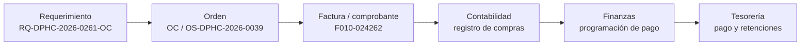

# 03. Logística: informe de los cinco archivos de `data/logistica/`

Archivos (todos del 12/11/2026; son **exportaciones** de un sistema, no libros con fórmulas):

| Archivo                                       | Qué es                                                                                                              | Filas                                                       |
| --------------------------------------------- | ------------------------------------------------------------------------------------------------------------------- | ----------------------------------------------------------- |
| `CONTROL DE REQUERIMIENTOS - 12-11-2026.xlsx` | Requerimientos (RQ) de compra o servicio                                                                            | 1,393 filas de ítem (396 RQ)                                |
| `CONTROL DE ORDENES - 12-11-2026.xlsx`        | Hoja `Análisis`: órdenes de compra / servicio (OC / OS) por ítem. Hoja `Facturas`: comprobantes recibidos por orden | 880 filas de ítem (368 órdenes); 309 facturas (279 órdenes) |
| `REPORTE-CONTABILIDAD-2026-11-12.xlsx`        | Registro de compras para contabilidad (periodo 01/10-30/11/2026)                                                    | 339 comprobantes                                            |
| `REPORTE-FINANZAS-2026-11-12.xlsx`            | El mismo registro, ya con programación de pago                                                                      | 338                                                         |
| `REPORTE-TESORERIA-2026-11-12.xlsx`           | El mismo registro, ya con datos de pago y retenciones                                                               | 333                                                         |

## 1. Idea central: una cadena de documentos

Cada paso añade información sobre el mismo documento. Un buen cuadro de mando de logística consiste en **medir el flujo y los tiempos entre pasos, y los importes que se pierden o cambian en cada uno**.

## 2. Control de Requerimientos (`REQ`)

**Estructura:** una fila por **ítem** solicitado; la cabecera (N.º de RQ, empresa, proyecto, tipo, estados, fechas) se **repite en cada ítem**. Para contar RQ hay que deduplicar por `N.º de requerimiento`.

**Campos clave:** N.º de requerimiento, empresa, proyecto / centro de costo, etapa (precontractual, elaboración de expediente, administrativo, en ejecución), tipo de RQ, estado, solicitante, comprador asignado, fechas de creación y aprobación, detalle del ítem (descripción, cantidad, unidad), precio y total (solo en 259 filas, ~19 %).

**Composición (396 RQ):**

| Estado                  | RQ  |
| ----------------------- | --- |
| Finalizado              | 197 |
| Rechazada               | 106 |
| Aprobada                | 48  |
| Observada               | 31  |
| Por regularización      | 11  |
| Pendiente de aprobación | 3   |

| Tipo de RQ     | RQ  |
| -------------- | --- |
| Emergencia     | 217 |
| Regularización | 120 |
| Rutinario      | 49  |
| Logístico      | 10  |

(A nivel de ítem: Emergencia 558, Rutinario 317, Regularización 259, Logístico 259.)

- **El 85 % de los RQ es de emergencia o regularización** (337 de 396). La regularización es compra hecha antes de tener RQ.
- Tasa de rechazo: 27 % de los RQ (106 de 396); en emergencia 70 de 217 (32 %), en rutinario 17 de 49 (35 %), en regularización 17 de 120 (14 %).
- Clase: servicios 260 RQ, bienes 136. Etapa del proyecto (RQ): en ejecución 182, precontractual 106, administrativo 80, elaboración de expediente 28.
- Empresas: DPHC concentra la mayor parte (921 ítems), seguida de DPH EIRL (450); hay casos aislados de Cosudeco, Perú Seguro 365, Consorcio Supervisor Junín y DPH Capital. 35 proyectos distintos.
- **Tiempo de aprobación del RQ:** promedio 1.1 días (mediana 0, máximo 13).
- **Precio solo en el 19 % de los ítems:** el RQ no sirve para medir presupuesto vs real sin completar ese campo.
- Rango de fechas: 05/10 a 11/11/2026 (aproximadamente 5 semanas de datos, no un año).

## 3. Control de Órdenes: hoja `Análisis`

**Estructura:** una fila por ítem de orden; cabecera repetida. Para contar órdenes hay que deduplicar por `N.º de orden`.

**Campos clave:** N.º de orden (`OC-` o `OS-` + empresa + año + correlativo), **RQ de origen** (o la palabra `REGULARIZACIÓN`), empresa emisora, proveedor, proyecto, centros de costo 1 y 2, condición de pago, moneda, fechas (aprobación del RQ, emisión, aprobación de la orden), estado de la orden, estado de entrega (Entregado / Pendiente / Parcial), ítem, cantidad, precio, total con IGV, emitido por.

**Composición (368 órdenes):**

| Estado de la orden              | Órdenes |
| ------------------------------- | ------- |
| Finalizada (pagada)             | 137     |
| Por pagar                       | 84      |
| Aprobada (sin facturar)         | 70      |
| Rechazada                       | 50      |
| Facturada (incluye "Observada") | 17      |
| Por aprobar                     | 5       |
| Otras variantes con "Observada" | 5       |

- **Importe emitido (sin rechazadas):** S/ 7.49 M y US$ 149 mil.
- Empresas emisoras (órdenes): DPHC 238, DPH EIRL 119, Cosudeco 8, y una de Perú Seguro 365, DPH Capital y Consorcio Supervisor Junín.
- **Proyectos con más compras:** Carretera (≈ S/ 3.22 M), Iguain (≈ 1.32 M), Collana (≈ 0.94 M), Oficina central (≈ 0.58 M), río Chochope (≈ 0.47 M). Suma de importes de distintas monedas sin convertir; es indicativo.
- 121 proveedores.
- **Condición de pago:** 19 textos distintos. "Contado a la recepción de factura" 197, "Adelanto / anticipado" 61, créditos de 5, 7, 15 y 30 días con variantes de escritura ("30 días" / "30 Días"). Hay que normalizar a un catálogo.
- **Regularización:** 151 de 880 filas (17 %) no tienen RQ de origen (`REGULARIZACIÓN`). Del resto, 222 de 223 RQ referenciados existen en el archivo de RQ.
- 174 de los 396 RQ no tienen orden asociada (incluye rechazados y pendientes).
- **Tiempo RQ aprobado → orden emitida:** promedio 1.6 días (máx. 14). **Emisión → aprobación de la orden:** promedio 0.5 días. Se detectan valores negativos (-1 y -4 días), es decir, aprobaciones con fecha anterior a la emisión: error de captura o de flujo.
- **Una orden con varios proyectos** (6 casos): cuando una orden atiende a más de un centro de costo, el proyecto cambia dentro de la misma orden y rompe el "una orden = un proyecto".
- El nombre del proyecto aparece de **varias formas** (`COLLANA`, `PROYECTO001 - COLLANA`; `Oficina Central`, `OFICINA - Oficina Central`; descripciones largas de obra en lugar de nombres cortos).

## 4. Control de Órdenes: hoja `Facturas`

Una fila por comprobante recibido para una orden. Campos: N.º de factura, N.º de orden, tipo de comprobante (factura 225, pasaje aéreo 60, RxH 18, pasaje terrestre 6), concepto (orden completa 238, anticipo 24, factura parcial, valorización N.º n...), fechas (emisión, vencimiento, pago), moneda, base, IGV, total, detracción, retención de garantía, estado.

- **Estados:** pago programado 164, pagada 109, pendiente de validación 28, en revisión 3, registrada en contabilidad 5.
- **Importe:** 233 comprobantes en soles (total S/ 3.69 M; base 3.15 M + IGV 0.54 M) y 76 en dólares (total US$ 126 mil). Detracción en 107 comprobantes (≈ 260 mil); retención de garantía en 10.
- **Antigüedad de deuda:** de 200 comprobantes no pagados, **144 ya están vencidos** al 12/11/2026 (S/ 2.30 M y US$ 23 mil vencidos).
- **Pagos:** solo 111 de 309 filas tienen `Fecha de pago`. Dos comprobantes tienen fecha de pago sin estar en estado "Pagada".
- Fecha de emisión mínima 06/11/2024: un registro con **fecha de un año anterior** (error de digitación).
- 43 de 279 órdenes tienen un total facturado distinto del total de la orden (36 facturado menos que lo ordenado; 7 más). Se explican en parte por pagos parciales y anticipos, pero 7 sobrefacturas requieren revisión.

## 5. Reportes de Contabilidad, Finanzas y Tesorería

**Son la misma tabla en tres momentos del proceso** (hoja `Compras`, encabezado en la fila 4, 42 → 48 → 56 columnas). Las columnas se acumulan: Finanzas añade programación y pago; Tesorería añade tipo de documento en texto, monto neto, nombre corto del proyecto, banco, N.º de cuenta, operación de retención.

| Grupo de columnas | Ejemplos                                                                                                                                                                                                              | Aparece en          |
| ----------------- | --------------------------------------------------------------------------------------------------------------------------------------------------------------------------------------------------------------------- | ------------------- |
| Documento         | Doc (código numérico: 1 → 246 comprobantes, 5 → 66, 2 → 17, 16 → 10; equivale probablemente a factura, pasaje aéreo, RxH y pasaje terrestre, por confirmar), serie y número, fecha de documento y vencimiento, moneda | Los tres            |
| Proveedor         | RUC, razón social                                                                                                                                                                                                     | Los tres            |
| Orden             | N.º OS/OC, monto de la orden                                                                                                                                                                                          | Los tres            |
| Importes          | Base imponible, IGV, no gravado, total, total en soles, detracción                                                                                                                                                    | Los tres            |
| Imputación        | Centros de costo 1 y 2 (código y nombre), glosa                                                                                                                                                                       | Los tres            |
| Estado            | Estado de pago                                                                                                                                                                                                        | Los tres            |
| Programación      | Fecha de programación, fecha programada de pago, día de pago, voucher, N.º de operación, reprogramación, cuotas                                                                                                       | Finanzas, Tesorería |
| Pago              | Tipo de documento (texto), monto neto, banco, cuenta, operación de retención, PROYECTO/PROGRAMA nombre corto                                                                                                          | Tesorería           |

**Totales en soles:** Contabilidad 3.75 M, Finanzas 3.72 M, Tesorería 3.67 M. La diferencia se debe a **comprobantes que salen en un reporte y no en el siguiente** (1 de Contabilidad no está en Finanzas; 5 de Finanzas no están en Tesorería).

**Estado de pago (en los reportes):** programado 124, pagado 120, por detracción/retención 69, pendiente de conformidad (observada) 18, conforme 5, en revisión 3.

**Hallazgos específicos**

- **MONTO OS/OC se repite en cada comprobante de la misma orden** (34 órdenes con más de un comprobante). Si se suma esa columna se obtienen 17.2 M; sumando una vez por orden resultan 6.9 M. No debe sumarse por comprobante.
- Columnas constantes o redundantes: RUC = RUC proveedor, razón social = nombre del proveedor, tipo = 1, tipo de documento de identidad = 6, "no gravado", "ad. no gravado", "I.S.C.".
- Un comprobante tiene fecha de documento 2024 (mismo error que en `Facturas`) y 2 comprobantes tienen total 0.
- 3 comprobantes sin centro de costo 1 ("Por ítem"): la imputación quedó pendiente.
- El **código de centro de costo 2** es texto con 3 dígitos en Órdenes (`017 - CC COLLANA`) y **número entero** en Contabilidad (17). El nombre largo es igual; la llave debe ser el código numérico.

## 6. Claves de relación y calidad de los cruces

| Cruce                                          | Llave                                              | Resultado                                                                                                                                                                                                                                           |
| ---------------------------------------------- | -------------------------------------------------- | --------------------------------------------------------------------------------------------------------------------------------------------------------------------------------------------------------------------------------------------------- |
| Orden → RQ                                     | `RQ de origen` = `N.º de requerimiento`            | 222 de 223 RQ referenciados existen. 151 filas sin RQ ("regularización")                                                                                                                                                                            |
| Factura → Orden                                | `N.º de orden`                                     | 279 de 279 facturas con orden                                                                                                                                                                                                                       |
| Contabilidad → Orden                           | `N° OS/OC` = `N.º de orden`                        | 271 de 271 coinciden (el prefijo empresa es el mismo en ambos archivos)                                                                                                                                                                             |
| Factura (Órdenes) ↔ Comprobante (Contabilidad) | N.º de factura                                     | **No es único**: la misma serie-número aparece en distintos proveedores (por ejemplo series E001-13). La llave correcta es **RUC del proveedor + número de comprobante**                                                                            |
| Importes                                       | Total (con IGV) vs Total                           | **35 de 281** comprobantes cruzados tienen importes distintos (por ejemplo 9,735 vs 120)                                                                                                                                                            |
| Estado                                         | `Estado` (Facturas) vs `Estado de Pago` (reportes) | No hay equivalencia 1 a 1 entre los catálogos de estado (Facturas: pago programado, pagada, pendiente de validación...; reportes: programado, pagado, por detracción/retención, pendiente de conformidad...). Hace falta una tabla de equivalencias |

**Centros de costo.** Hay dos niveles:

- **CC2 (dónde se carga el costo):** áreas (001 Gerencia, 002 Administración, 003 Finanzas, 004 Contabilidad, 005 Logística, 006 Almacén, 007 Licitaciones, 008 Proyectos, 011 RR. HH., 014 TI, 015 Comunicaciones), centros generales (020 Piura, 021 Tumbes, 022 Ica, 049 Lima, 050 Trujillo) y proyectos concretos (017 Collana, 018 Carretera, 019 Iguain, 023-065 obras específicas).
- **CC1 (qué partida):** partidas de presupuesto de obra (`OE.2.1`, `HU.3.5`, `1.2.1.5`, `01.03.01`...), gastos (`GA` administrativos, `GGF` generales fijos, `GGV` generales variables), subcontratos (`SUBC01`...) o "Por ítem". No hay una lista única; depende del proyecto.

## 7. Datos sensibles

Los campos de texto libre (observaciones, especificaciones, glosas) pueden contener **números de cuenta, DNI y fechas de nacimiento**. No deben pasar al repositorio ni a los reportes sin depurar.

## 8. Qué es dato clave para el cuadro de mando

| Dato                                                              | Fuente                        | Uso                                           |
| ----------------------------------------------------------------- | ----------------------------- | --------------------------------------------- |
| Embudo RQ → orden → factura → pago (cantidad e importe por etapa) | REQ, ORD, Facturas, reportes  | Cumplimiento del proceso de compras           |
| Tiempos entre etapas                                              | Fechas de los cuatro archivos | Eficiencia y cuellos de botella               |
| Compras por proyecto, centro de costo, partida y proveedor        | `Análisis` + CC1/CC2          | Gasto comprometido y concentración            |
| Tipo de RQ (emergencia, regularización)                           | REQ                           | Planificación de compras                      |
| Deuda vencida y calendario de pagos                               | Facturas, Finanzas, Tesorería | Caja y relación con proveedores               |
| Estado de conformidad y retenciones                               | Reportes                      | Riesgo tributario (detracciones, retenciones) |

## 9. Cómo se automatizaría

1. Cargar REQ, Órdenes y Facturas como tablas largas, con una cabecera deduplicada por documento y otra por ítem.
2. Cargar Contabilidad / Finanzas / Tesorería como **una sola tabla** con una columna de "etapa" y la fecha del reporte, en lugar de tres archivos.
3. Usar **llaves únicas** (`RQ`, `orden`, `RUC + comprobante`, `código CC2`) y reglas de calidad al cargar (importes, fechas, estados).
4. Mantener un **diccionario de equivalencias** de estados entre sistemas.

Ver [07_archivos_limpios.md](07_archivos_limpios.md).
