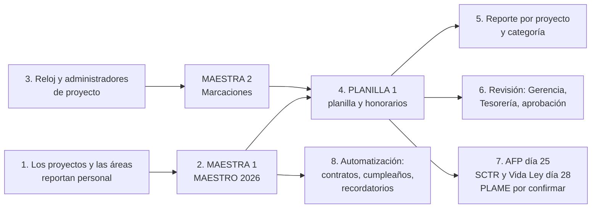

# 04. RR. HH.: informe de los archivos de `data/rrhh/`

**Alcance:** seis archivos más el mapa de proceso `rrhh.mmd` (flujo AS-IS de ocho subprocesos). Los datos están **anonimizados y son pocos** (5 personas en el maestro, 5 filas de ejemplo en la planilla); sirven para entender la **estructura y la lógica**, no para medir resultados. Por eso aquí no hay cifras reales de personal salvo las de las marcaciones.

| Archivo                                                | Papel en el proceso (`rrhh.mmd`)                            |
| ------------------------------------------------------ | ----------------------------------------------------------- |
| `MAESTRO 2026.xlsx`                                    | MAESTRA 1: base mensual de personal                         |
| `Marcaciones al 09.11.txt`                             | MAESTRA 2: marcaciones del reloj de asistencia              |
| `10. PLANILLA EJEMPLO.xlsx`                            | PLANILLA 1: cálculo mensual de planilla y honorarios        |
| `10. FORMATO PLANILLA OCTUBRE IGUAIN - FINAL (1).xlsx` | Reporte de costo de personal por proyecto (versión llenada) |
| `Formato declarar AFP.xlsx`                            | Formato de carga de AFP (trámite día 25)                    |
| `MODELO TRAMA SCTR DPHC.xls`                           | Trama de SCTR / Vida Ley (trámite día 28)                   |
| `rrhh.mmd`                                             | Diagrama del proceso                                        |

La plantilla vacía y su ejemplo (`FORMATO - PLANILLA RECURSOS HUMANOS*.xlsx`) están en `data/proyectos/` y se describen en la sección 5.

## 1. Flujo del proceso (resumen de `rrhh.mmd`)

Observaciones sobre el flujo:

- Hay dos orígenes de información: **administradores de proyecto** (obreros, personal clave y no clave) y **jefes de área** (administrativos y especialistas). Ambos usan hojas de cálculo compartidas separadas por vínculo: planilla o recibo por honorarios (RH).
- El **cruce de MAESTRA 1 con MAESTRA 2** (personas contra marcaciones) lo hace RR. HH. a mano antes de calcular la planilla.
- El diagrama marca dos puntos de "**vista de acceso**" (reportes que debe ver gerencia): el reporte de costos de personal por empresa, proyecto y categoría (subproceso 5) y la revisión de la planilla (subproceso 6). Son candidatos directos a pestañas del cuadro de mando.
- El PLAME (declaración a SUNAT) no tiene fecha confirmada ni formato entregado.

## 2. `MAESTRO 2026.xlsx` (MAESTRA 1)

Hoja `11` (mes noviembre): encabezado en la fila 9, **34 columnas**, una fila por persona. Solo hay 5 filas de ejemplo anonimizadas.

| Grupo            | Columnas                                                                                                                                                                                                 |
| ---------------- | -------------------------------------------------------------------------------------------------------------------------------------------------------------------------------------------------------- |
| Identificación   | N.º, DNI, apellidos y nombres, suspensión                                                                                                                                                                |
| Relación laboral | Empresa contratante (DEPERU HUB EIRL / DPHC SAC / DPH CARGA SAC), área, cargo, **proyecto**, fecha de ingreso, fin de contrato, observación (`FIRMADO` / `ELABORAR CONTRATO`), modalidad (planilla / RH) |
| Remuneración     | Sueldo, asignación familiar                                                                                                                                                                              |
| Contacto         | Correos, dirección, teléfono, firma corporativa                                                                                                                                                          |
| Pago             | Banco, número de cuenta                                                                                                                                                                                  |
| Previsión        | AFP / ONP, CUSPP                                                                                                                                                                                         |
| Perfil           | Fecha de nacimiento, **edad = `DATEDIF` contra `TODAY()`**, sexo, sede, grado, profesión, universidad, datos de padres, N.º de hijos                                                                     |

Lógica: solo la **edad** es fórmula. Todo lo demás es captura manual.

Relevancia: es la **fuente de verdad del personal**. La planilla, honorarios, AFP, SCTR y el reporte por proyecto deberían salir de aquí, pero hoy cada archivo repite los datos de la persona.

Defectos: no hay historial (una hoja por mes, no un registro con vigencia); el proyecto es texto libre; hay datos personales sensibles mezclados con datos operativos (cuenta, familia).

## 3. `Marcaciones al 09.11.txt` (MAESTRA 2)

Archivo de texto, **831 líneas**, separado por tabuladores, volcado del reloj de asistencia.

| Campo | Contenido                                                                            |
| ----- | ------------------------------------------------------------------------------------ |
| 1     | Código de persona: DNI sin ceros a la izquierda, o códigos internos de 1 a 2 dígitos |
| 2     | Fecha y hora `dd/mm/aaaa hh:mm`                                                      |
| 3 a 6 | Campos casi constantes del reloj (1, 255, 1 o 15, 0)                                 |

- Rango: 26/10/2026 a 09/11/2026 (15 días). **52 códigos distintos.**
- **No hay indicador de entrada o salida**: solo marcas de tiempo. Hay que inferir (primera marca = entrada, última = salida).
- 6 líneas duplicadas exactas (doble pulsación o doble descarga) y 1 línea mal formada (un campo de nombre desplaza las columnas).
- El código no tiene el mismo formato que el DNI de `MAESTRO` (sin ceros a la izquierda y con códigos internos): el cruce necesita normalizar.
- Resultado útil: **horas de ingreso y salida por día**, tardanzas y faltas, que alimentan la columna de tardanza de la planilla.

## 4. `10. PLANILLA EJEMPLO.xlsx` (PLANILLA 1)

### 4.1 Hoja `PLANILLA` (personal en planilla)

- Cabecera: periodo y **días del mes en `J1` (30)**; `AA1` es la RMV usada para la asignación familiar (1,230; asignación = 10 %).
- **64 columnas** en cuatro grandes bloques:
  1. **Ingresos afectos:** días trabajados, faltas, vacaciones, descanso médico, asignación familiar, bonificaciones, reintegros.
  2. **Ingresos no afectos:** movilidad y otros.
  3. **Descuentos:** adelantos, **tardanza** (minutos o horas: `valor/30/8 × horas`), no deducibles.
  4. **Base de aportes y retenciones (PLAME):** base de aportación `= remuneración − descuentos…`; sistema de pensiones (AFP u ONP), nombre de AFP, CUSPP, comisión (flujo o mixta); **aporte obligatorio 10 % (AFP) o 13 % (ONP)**, prima de seguro y comisión variable según la AFP (tabla en `AFP-ONP`).
- Luego: EPS, **neto a pagar**, **EsSalud 9 % con base mínima 1,130**, seguro de vida, banco, cuenta, y provisiones de CTS, gratificación y vacaciones.
- Solo 5 filas de ejemplo; las fórmulas están pensadas para copiarse hacia abajo.

### 4.2 Hoja `AFP-ONP`

Tabla de parámetros: comisión por flujo (Habitat 1.47 %, Integra 1.55 %, Prima 1.60 %, Profuturo 1.69 %) y prima de seguro (1.37 %). Es el **tipo de dato que debe ser un parámetro con vigencia** en el sistema.

### 4.3 Hoja `HONORARIOS` (recibos por honorarios)

Columnas: sueldo básico, indicador de **retención de renta de 4.ª categoría (8 %)** si aplica, días, importe `= sueldo/30 × días`, movilidad, adelantos, préstamos, neto, **"Recibo emitido SI/NO" → `PAGAR` / `NO PAGAR`**, banco, cuenta. Unas 12 filas de ejemplo.

Este indicador es un **control de pago** importante: no se paga a quien no ha entregado su recibo.

### 4.4 Hoja `Hoja1` (resumen)

Resumen con cifras **escritas a mano**: planilla 39 trabajadores (S/ 274,715), honorarios 78 (S/ 368,147), total 117 personas (S/ 642,862), distribuidos en tres sedes (Unanue, Ricardo Palma y Carabayllo). No es fórmula; no cuadra con las hojas de detalle de ejemplo (que solo tienen 5 y 12 filas).

### 4.5 Hoja `BOLETA`

Plantilla de boleta (doble ejemplar) enlazada a la fila 5 de `PLANILLA`. Texto fijo desactualizado ("Desde 01/05/2026").

## 5. Formato de planilla por proyecto (`FORMATO - PLANILLA RECURSOS HUMANOS.xlsx`, su ejemplo y la versión llenada de Iguain)

Es el archivo que **cada administrador de proyecto** entrega a RR. HH. cada mes con el costo bruto de su personal.

### 5.1 Estructura

- Cabecera: **Empresa** (D3), **Proyecto** (D4), **Mes** (D5). `I5 = DAY(EOMONTH(D5,0))` calcula los días del mes.
- **Cuatro bloques:** personal clave, personal no clave, personal administrativo y mano de obra.
- Columnas por persona: N.º, DNI, apellidos y nombres, cargo, **condición** (`PLANILLA` o `RxH`), banco, CCI, fecha de inicio, días laborados, sueldo base acordado, **sueldo bruto = base / días del mes × días laborados**, observaciones.
- Dos resúmenes con `SUMIF`: por **categoría** y por **condición**. Ambos deberían dar el mismo total.
- El ejemplo (carretera JU104, setiembre 2026, DPHC) totaliza S/ 54,800.

### 5.2 Versión llenada (Iguain, octubre 2026, DEPERU HUB EIRL)

Bloques de 4 personas clave, 6 no clave, 3 administrativas y 15 de mano de obra. Total S/ 103,426.94 por categoría contra S/ 103,126.94 por condición:

- La diferencia de **S/ 300** viene de una fila que el `SUMIF` omite (condición mal escrita).
- Dos celdas de sueldo tienen **valores digitados** (5,100 y 300) que sobrescriben la fórmula.
- Una fila declara **36 días** en un mes de 31.
- Un **CCI está repetido** en dos personas.
- El proyecto es texto libre ("RESERVORIO IGUAIN-01043"): no coincide con los nombres de Logística ni de Proyectos.

### 5.3 Utilidad

Es la **única fuente de costo de personal por proyecto, empresa y categoría**. Es también la fuente que debe conciliarse con los gastos de RR. HH. que se registran en `Gastos` de cada proyecto.

## 6. Formatos para terceros

### `Formato declarar AFP.xlsx` (trámite día 25)

Hoja con 17 columnas: secuencia, CUSPP, tipo de documento (0 = DNI), número, apellidos y nombres, relación laboral (S/N), inicio de relación laboral (S/N), cese (S/N), excepción de aportar, **remuneración asegurable**, aportes voluntarios (tres columnas), tipo de trabajo (N = dependiente) y AFP. La fila 3 tiene las instrucciones. Se llena con datos de `MAESTRO` (identificación, CUSPP) y de `PLANILLA` (remuneración asegurable).

### `MODELO TRAMA SCTR DPHC.xls` (trámite día 28)

Hoja `trama` con campos obligatorios: nombres, apellidos, tipo y número de documento, sexo, fecha de nacimiento, moneda, remuneración (referencia: 1,130 RMV), estado civil, sede. Hoja `Data` con listas (países, ocupaciones). El estado civil no figura en el maestro.

Ambos formatos se pueden **generar por completo** a partir de `MAESTRO` + `PLANILLA` si los datos de origen están completos y con los mismos nombres de campo.

## 7. Relaciones

- **Llave natural: DNI.** Aparece en `MAESTRO`, `PLANILLA`, `HONORARIOS`, el formato de proyecto, AFP, SCTR y (con otro formato) en las marcaciones. Un mismo DNI se repite entre maestro y formato de proyecto.
- **Empresa y proyecto** (texto libre) son la llave hacia Proyectos y Logística: hay que convertirlos al código de centro de costo.
- **Costos:** el total del formato por proyecto debe cuadrar con el costo de RR. HH. que figura en `Gastos` del proyecto y con la planilla pagada por Tesorería.
- **Honorarios (RxH):** los comprobantes de tipo "Recibo por honorarios" también aparecen en Logística (18 comprobantes), lo que genera un posible doble registro con la planilla de honorarios.

## 8. Hallazgos de calidad

1. Mismos datos de persona en cinco archivos, con captura manual repetida.
2. Proyecto y empresa como texto libre; sin código.
3. Marcaciones con códigos de formato distinto al DNI, duplicados y una línea mal formada.
4. Resúmenes escritos a mano (`Hoja1`), valores digitados sobre fórmulas, `SUMIF` con criterios mal escritos y días fuera de rango.
5. Parámetros legales (comisiones AFP, 9 % EsSalud, RMV, 8 % renta de cuarta) incrustados en celdas, sin fecha de vigencia.
6. Base de personal por mes en hojas separadas: no hay histórico de altas, bajas y cambios.
7. Datos personales y bancarios en todos los archivos; no deben subirse al repositorio (ver `GUIA_TRABAJO.md`).
8. No existe formato de PLAME ni de contratos; en la práctica, parte del proceso sigue sin datos.

## 9. Datos clave para el cuadro de mando

| Dato                                                           | Fuente                                    | Uso                        |
| -------------------------------------------------------------- | ----------------------------------------- | -------------------------- |
| Plantilla vigente por empresa, proyecto, categoría y condición | `MAESTRO`                                 | Dotación y rotación        |
| Costo bruto mensual por proyecto y categoría                   | Formato por proyecto                      | Costo de personal y margen |
| Costo total de planilla y honorarios                           | `PLANILLA`, `HONORARIOS`                  | Presupuesto de RR. HH.     |
| Asistencia y tardanzas                                         | Marcaciones                               | Productividad y descuentos |
| Contratos por firmar o por vencer                              | `MAESTRO` (observación y fin de contrato) | Riesgo laboral             |
| Calendario de obligaciones (AFP 25, SCTR 28, PLAME)            | `rrhh.mmd`                                | Cumplimiento               |

Ver [06_propuesta_kpi.md](06_propuesta_kpi.md) y [07_archivos_limpios.md](07_archivos_limpios.md).
