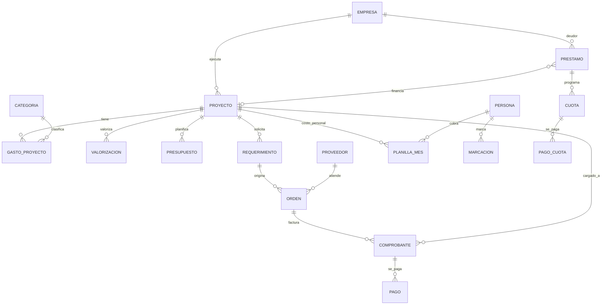

# 05. Estructura del cuadro de mando y modelo de datos

Propuesta de la estructura general (árbol de pantallas) y del modelo de datos común que la sostiene. Es una **propuesta para validar** con los responsables de cada área; no está implementada.

## 1. Principios

1. **Una sola fuente por dato.** Cada dato se carga una vez desde la oficina que lo origina; los demás lo consultan.
2. **Dimensiones compartidas.** Empresa, proyecto / centro de costo, periodo, moneda y categoría son los mismos en todas las áreas. Sin esto no se pueden cruzar costos de personal, compras y deuda.
3. **Tablas largas, no matrices.** Una fila por hecho (una cuota, un comprobante, una marcación, un gasto). Los totales y las matrices los calcula el sistema.
4. **Información sensible fuera del cuadro de mando.** Cuentas, DNI y nombres solo en el sistema de gestión, nunca en las vistas públicas ni en Git.
5. **Cada indicador trae su definición** (fórmula, fuente, alcance, frecuencia): ver [06_propuesta_kpi.md](06_propuesta_kpi.md).

## 2. Árbol del cuadro de mando

```mermaid
flowchart TB
    ROOT[Cuadro de mando DPH]
    ROOT --> G[0. Resumen gerencial]
    ROOT --> P[1. Proyectos]
    ROOT --> L[2. Logística y pagos]
    ROOT --> F[3. Préstamos y deuda]
    ROOT --> H[4. Recursos humanos]
    ROOT --> Q[5. Calidad de datos]

    G --> G1[Semáforo por área]
    G --> G2[Caja comprometida próximos 30 y 60 días]
    G --> G3[Margen y avance de los proyectos activos]
    G --> G4[Alertas del mes]

    P --> P1[Cartera de proyectos]
    P --> P2[Ficha del proyecto: datos, plazos, contrato]
    P --> P3[Valor ganado: PV, EV, AC, CPI, SPI]
    P --> P4[Gasto por componente y categoría]
    P --> P5[Valorización y cobro]
    P --> P6[Flujo de caja proyectado vs real]

    L --> L1[Embudo RQ - orden - factura - pago]
    L --> L2[Tiempos de ciclo]
    L --> L3[Compras por proyecto, partida y proveedor]
    L --> L4[Cuentas por pagar y vencidos]
    L --> L5[Calendario de pagos]
    L --> L6[Conciliación orden - factura - contabilidad]

    F --> F1[Deuda total, capital e intereses]
    F --> F2[Vencimientos por mes]
    F --> F3[Concentración por acreedor]
    F --> F4[Costo financiero por préstamo]
    F --> F5[Cuotas del mes y recordatorios]

    H --> H1[Dotación por empresa, proyecto y categoría]
    H --> H2[Costo de personal por proyecto]
    H --> H3[Asistencia y tardanzas]
    H --> H4[Contratos y altas y bajas]
    H --> H5[Calendario de obligaciones AFP, SCTR, PLAME]

    Q --> Q1[Archivos recibidos y fecha de corte]
    Q --> Q2[Errores de carga por oficina]
    Q --> Q3[Diferencias entre áreas]
```

### Descripción de las pestañas

| Pestaña                  | Pregunta que responde                                                                                | Quién la mira                  |
| ------------------------ | ---------------------------------------------------------------------------------------------------- | ------------------------------ |
| **0. Resumen gerencial** | ¿Cómo estamos hoy y qué requiere decisión? Semáforo por área, caja comprometida, proyectos en riesgo | Gerencia                       |
| **1. Proyectos**         | ¿Cada proyecto avanza según lo planificado y a costo controlado?                                     | Gerencia, jefes de proyecto    |
| **2. Logística y pagos** | ¿Se compra a tiempo y se paga lo que corresponde? ¿Qué se debe y a quién?                            | Logística, Finanzas, Tesorería |
| **3. Préstamos y deuda** | ¿Cuánto debemos, cuándo vence y cuánto cuesta?                                                       | Gerencia, Finanzas             |
| **4. Recursos humanos**  | ¿Cuánto personal tenemos, cuánto cuesta y qué obligaciones vencen?                                   | RR. HH., Gerencia              |
| **5. Calidad de datos**  | ¿Los archivos están completos y consistentes?                                                        | Equipo del cuadro de mando     |

La pestaña de **calidad de datos** es clave: sin ella los números del resumen se pueden creer o desconfiar sin evidencia.

## 3. Modelo de datos común

### 3.1 Dimensiones (catálogos compartidos)

| Dimensión                      | Llave                                              | Atributos                                                                                                      | Origen actual                                                  | Propietario sugerido     |
| ------------------------------ | -------------------------------------------------- | -------------------------------------------------------------------------------------------------------------- | -------------------------------------------------------------- | ------------------------ |
| **Empresa**                    | RUC                                                | Razón social, nombre corto (DPH, DPHC, DPH Carga, Cosudeco, Perú Seguro 365, DPH Capital)                      | Reportes de Contabilidad, `MAESTRO`                            | Contabilidad             |
| **Centro de costo / proyecto** | Código CC2 (3 dígitos)                             | Nombre corto, tipo (área, general de sede, proyecto), código de proyecto (CUI/código), entidad, estado, fechas | Contabilidad (CC2), Logística (`Proyecto`), Collana (INF-Gral) | Proyectos                |
| **Partida / categoría**        | Código de categoría                                | Componente, ítem, etapa, tipo de costo, categoría especial                                                     | `categorias_global`, CC1 de Contabilidad                       | Proyectos + Contabilidad |
| **Proveedor**                  | RUC                                                | Razón social                                                                                                   | Órdenes, Contabilidad                                          | Logística                |
| **Persona**                    | DNI (texto de 8 dígitos, con ceros a la izquierda) | Empresa, cargo, categoría, condición, proyecto, fechas de contrato                                             | `MAESTRO`                                                      | RR. HH.                  |
| **Acreedor / préstamo**        | Código de préstamo                                 | Acreedor, deudor, tipo, moneda, tasa, plazo                                                                    | `RPT_MAPA`, hojas FIN-*                                        | Finanzas                 |
| **Periodo**                    | Año-mes                                            | Mes, trimestre, año                                                                                            | Calendario                                                     | Sistema                  |
| **Moneda y tipo de cambio**    | Fecha + moneda                                     | TC compra / venta                                                                                              | Hoy hay un TC fijo en cada archivo (3.5 y 3.45)                | Tesorería                |

### 3.2 Hechos (tablas largas)

| Hecho                    | Granularidad                       | Llave                            | Origen                                         | Dimensiones                                   |
| ------------------------ | ---------------------------------- | -------------------------------- | ---------------------------------------------- | --------------------------------------------- |
| **Gasto de proyecto**    | Un pago o gasto proyectado         | ID de gasto                      | `Gastos` de cada proyecto                      | Proyecto, categoría, proveedor, fecha, moneda |
| **Valorización**         | Proyecto × mes × partida (o total) | Proyecto + mes                   | `Valorizaciones`, `Resumen-Valorizaciones`     | Proyecto, periodo                             |
| **Presupuesto**          | Proyecto × escenario × partida     | Proyecto + escenario + partida   | `EO-PPTOs`                                     | Proyecto, partida                             |
| **Requerimiento (ítem)** | Un ítem de RQ                      | N.º RQ + N.º ítem                | REQ                                            | Empresa, proyecto, CC1/CC2                    |
| **Orden (ítem)**         | Un ítem de orden                   | N.º orden + N.º ítem             | ORD `Análisis`                                 | Empresa, proyecto, proveedor, CC1/CC2         |
| **Comprobante**          | Un comprobante                     | **RUC proveedor + serie-número** | ORD `Facturas`, Contabilidad                   | Empresa, proveedor, CC1/CC2, orden            |
| **Programación y pago**  | Un pago a un comprobante           | Comprobante + fecha de pago      | Finanzas, Tesorería                            | Comprobante                                   |
| **Cuota de préstamo**    | Una cuota                          | Préstamo + N.º cuota             | `BD_CUOTAS` y hojas FIN-*                      | Préstamo, periodo                             |
| **Pago de cuota**        | Un pago real                       | Préstamo + cuota + fecha         | (hoy no existe como tabla)                     | Préstamo                                      |
| **Planilla mensual**     | Persona × mes                      | DNI + periodo                    | `PLANILLA`, `HONORARIOS`, formato por proyecto | Persona, proyecto, empresa                    |
| **Marcación**            | Una marca de reloj                 | Código + fecha-hora              | Archivo del reloj                              | Persona                                       |

### 3.3 Relaciones entre áreas

Las cinco "uniones" que hoy **no existen** y que el modelo introduce:

| Unión                                  | Hoy                                                             | Propuesta                                                              |
| -------------------------------------- | --------------------------------------------------------------- | ---------------------------------------------------------------------- |
| Gasto de proyecto ↔ orden / RQ         | La columna `RQ` de `Gastos` está vacía                          | Registrar N.º de orden (y RQ) en cada gasto que provenga de una compra |
| Gasto de proyecto ↔ comprobante / pago | IDs de Administración, Tesorería y Finanzas parcialmente llenos | Un único ID de comprobante o de pago                                   |
| Planilla ↔ proyecto                    | Texto libre                                                     | Código CC2 en el formato de planilla y en `MAESTRO`                    |
| Préstamo ↔ proyecto                    | Cuotas anotadas como gasto de proyecto                          | Campo "proyecto financiado" y tipo de gasto financiero                 |
| Persona ↔ marcación                    | Código del reloj distinto al DNI                                | Tabla de equivalencia código del reloj ↔ DNI                           |

## 4. Reglas de integridad mínimas

| Regla                                                                         | Dónde se aplica                         |
| ----------------------------------------------------------------------------- | --------------------------------------- |
| El código de proyecto (CC2) existe en el catálogo                             | Gastos, órdenes, comprobantes, planilla |
| El comprobante es único por RUC + serie-número                                | Contabilidad, Facturas                  |
| Toda orden con comprobante tiene RQ o la marca explícita de regularización    | Órdenes                                 |
| La suma de comprobantes de una orden no supera su total (salvo justificación) | Órdenes ↔ Facturas                      |
| El importe de un comprobante coincide entre Logística y Contabilidad          | Facturas ↔ Contabilidad                 |
| Días laborados ≤ días del mes                                                 | Planilla                                |
| La suma por categoría = la suma por condición                                 | Formato de planilla por proyecto        |
| Cuota pagada tiene fecha y operación de pago                                  | Préstamos                               |
| Moneda y TC definidos para cada importe                                       | Todos                                   |

## 5. Cómo encaja con los archivos actuales

| Archivo actual                    | Cómo entra al modelo                                                                                                                                                           |
| --------------------------------- | ------------------------------------------------------------------------------------------------------------------------------------------------------------------------------ |
| `Collana 09-11.xlsx`              | `Gastos` → Gasto de proyecto; `EO-PPTOs` → Presupuesto; `Valorizaciones` → Valorización; `categorias_global` → Categoría. Los informes `INF-*` se **recalculan** en el sistema |
| Formato de planilla por proyecto  | Planilla mensual                                                                                                                                                               |
| `MAESTRO 2026.xlsx`               | Persona                                                                                                                                                                        |
| `PLANILLA` / `HONORARIOS`         | Planilla mensual (detalle de cálculo)                                                                                                                                          |
| Marcaciones                       | Marcación                                                                                                                                                                      |
| REQ, ORD, `Facturas`              | Requerimiento, Orden, Comprobante                                                                                                                                              |
| Contabilidad, Finanzas, Tesorería | Comprobante + Programación y pago (una sola tabla con la etapa)                                                                                                                |
| Archivo de préstamos              | Catálogo de préstamos + Cuota (+ Pago de cuota nuevo)                                                                                                                          |

Los entregables limpios que cada oficina debe preparar se describen en [07_archivos_limpios.md](07_archivos_limpios.md).
